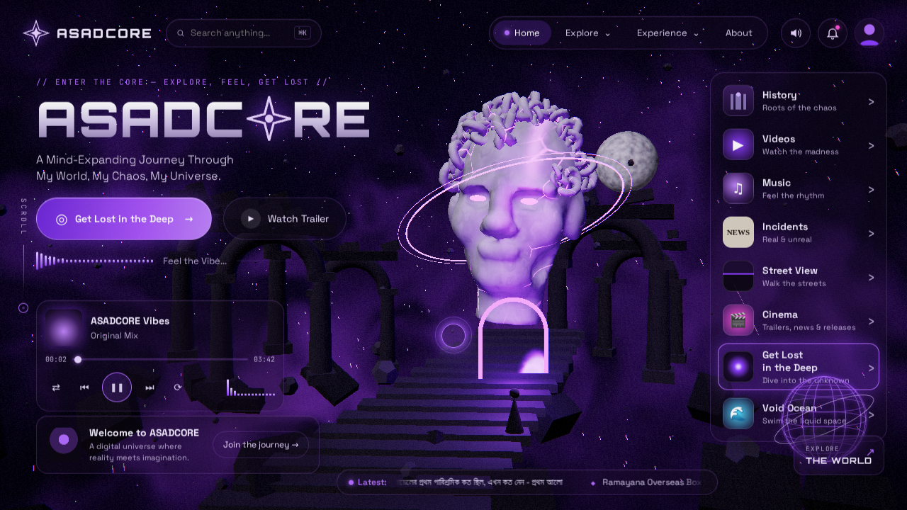

# ASADCORE v2



A cinematic, Bangladeshi-flavored dark-cosmic WebGL universe. Old Dhaka streets, rickshaw bells, Bangla whispers, a broken marble statue, real streaming media, live cinema news, and a swim-through void ocean — all wrapped in a purple glass UI.

**Live demo:** _add your Vercel URL here after deploying_  
**Target repo:** <https://github.com/ahabib69/asadcore>

## Stack

- Vite + vanilla TypeScript
- Three.js + custom GLSL + EffectComposer bloom/post
- GSAP / ScrollTrigger + Lenis
- Web Audio API generative ambient engine + real-track playback/ducking
- YouTube IFrame Player API, `hls.js`, Mapillary JS (optional)
- TMDB API (optional) + Vercel serverless RSS aggregator (`/api/news`)
- Jamendo API (optional CC music)

## What is inside

| Tab | What works |
| --- | --- |
| Home | Procedural hero, generative soundtrack, mini-player, live news ticker, 8 explore cards |
| History | Scroll-through Dhaka/Bangladesh chapters |
| Videos | 28 verified YouTube embeds across 7 categories, search/tabs, cinematic player, next autoplay, direct MP4/HLS support, shader-ripple 3D gallery |
| Music | 36 real tracks (Internet Archive CC + YouTube embeds), genre filter, playlist, play/pause/next/prev/shuffle/repeat/seek/volume, AnalyserNode visualizer, procedural ambient ducks smoothly |
| Incidents | Fictional/real-blurred Dhaka files |
| Street View | 16 real Wikimedia Commons panorama locations, location picker, random place, inter-place hotspots, drag-look, mobile gyroscope, per-location ambient, optional Mapillary/Google Street View |
| Cinema | TMDB Now Playing / Trending / Top Grossing / Upcoming, Hollywood/Bollywood/Bangla tabs, posters/ratings/dates/budget/revenue, trailer popup, countdowns + local “Notify me”, live RSS news, floating 3D poster cards. Works without a key via a verified sample catalogue. |
| Get Lost in the Deep | Infinite fall, layers, whispers, core |
| Void Ocean | Free-swim liquid space: WASD/arrows + mouse look, Space/Shift rise/sink, B boost, touch joystick, momentum/drag, asteroids, moon, sun/flare, ringed planet, leviathans, caustic rays, bubbles, depth fog, generative underwater audio, 5 hidden secrets, Auto/1080p/4K quality + FPS auto-reduce, Surface button |
| Hidden Door | Secret mini-scene |

There are **12 secrets** total. The counter lives in the profile panel.

## Run locally

```bash
npm install
npm run dev
```

Open the printed URL (default `http://localhost:5173`). Click **ENTER** to start audio — browsers block autoplay. Headphones recommended.

```bash
npm run build      # type-check + production build to dist/
npm run preview    # serve the production build locally
npm run check      # type-check only
npm run test:smoke # Playwright acceptance pass (desktop + mobile screenshots)
```

The smoke test expects a dev/preview server on `http://localhost:5173` (or set `URL=`). It writes screenshots to `shots/` and exits non-zero on app console errors.

```bash
npx playwright install chromium   # once
npm run dev &                     # or npm run preview &
URL=http://localhost:5173 npm run test:smoke
```

## Optional API keys

Copy `.env.example` to `.env.local` and fill only what you need. **Never commit `.env.local`.** The app works without any key.

| Variable | Purpose | Get a free key |
| --- | --- | --- |
| `VITE_TMDB_KEY` | Live Cinema data (Now Playing / Trending / Top Grossing / Upcoming) | <https://www.themoviedb.org/settings/api> |
| `VITE_MAPILLARY_TOKEN` | Real street-level imagery in Street View | <https://www.mapillary.com/developer> |
| `VITE_GOOGLE_MAPS_KEY` | Optional Google Street View embed | <https://console.cloud.google.com/google/maps-apis> |
| `VITE_JAMENDO_ID` | Extra Creative Commons music merged into the playlist | <https://devportal.jamendo.com/> |

Without `VITE_TMDB_KEY`, Cinema shows a built-in, verified sample catalogue and a clear banner. Without Mapillary/Google keys, Street View falls back to Wikimedia Commons panoramas.

## Edit content

Almost all editable content lives in **`src/config.ts`**:

- `videos[]` — add `{ title, category, ytId, line }` or `{ title, category, src, line }` for direct MP4/HLS. YouTube IDs are checked at runtime; unavailable/non-embeddable items are hidden/skipped.
- `music[]` — add `{ title, artist, genre, src | ytId, cover, license }`. `src` should be a CORS-friendly audio URL (Internet Archive works well). `ytId` uses a YouTube embed with simulated beat fallback.
- `locations[]` — add `{ id, name, region, panorama, license, lat, lng, ambient }`. `panorama` should be an equirectangular or wide panorama URL. Wikimedia Commons URLs are automatically thumbnailed for weak devices.
- `history[]`, `incidents[]`, `whispers[]`, `layers[]`, `ticker[]` — story content.

Cinema sample data lives in `src/media/tmdb.ts`. RSS sources live in `api/news.ts`.

### Media licenses

The built-in music uses Internet Archive items under CC BY / BY-SA / BY-NC / BY-ND licenses plus YouTube embeds. Panorama images are Wikimedia Commons files under their respective CC licenses. Keep attribution/license fields when adding media. YouTube content is embedded, not downloaded.

## Deploy to Vercel

1. Push this repo to GitHub.
2. Import the repo in Vercel.
3. Framework preset: **Vite**. Build command `npm run build`, output directory `dist`.
4. Add any optional environment variables in Project Settings → Environment Variables.
5. Deploy.

`/api/news` is a Vercel serverless function that fetches/parses/caches movie RSS feeds for 15 minutes (Variety, Hollywood Reporter, Bollywood Hungama, Pinkvilla, The Daily Star, Prothom Alo, bdnews24). The Vite dev/preview servers expose the same endpoint locally.

Any static host can serve `dist/`, but the live news ticker/Cinema news need the serverless function (or you can replace `/api/news` with your own proxy).

## Controls

- **Home / scenes:** mouse move for parallax, scroll/drag galleries.
- **Videos:** click a poster or list item; Next ▸ autoplays the next visible video.
- **Music:** playlist + genre tabs; volume slider; “Generative ambient” returns to the procedural engine.
- **Street View:** drag to look, click glowing hotspots to travel, 🎲 Random, 📱 Gyro on mobile.
- **Cinema:** industry + category tabs, click a poster for details/trailer/notify.
- **Void Ocean:** WASD/arrows to swim, mouse drag to look, Space rise, Shift sink, B boost. On touch, use the joystick + drag. Click glowing objects for secrets. ↑ Surface returns home.
- **Deep:** scroll/drag to fall faster. ↑ Rise returns home.
- **Secrets:** click the star in the wordmark, find the rickshaw bell, reach the core, scroll history to the end, read incident 001, enter the Konami code, and find the 5 ocean objects.

## GitHub

This workspace could not push automatically (no `gh` CLI or GitHub token available). To publish manually:

1. Create a new **public** repo named `asadcore` under `ahabib69` (do not initialize it with a README).
2. Then run:

```bash
cd asadcore
git add .
git commit -m "feat: ASADCORE v2 — real media, cinema, void ocean"
git branch -M main
git remote add origin https://github.com/ahabib69/asadcore.git
git push -u origin main
```

If the repo already has commits in this folder, just add the remote and push:

```bash
git remote add origin https://github.com/ahabib69/asadcore.git
git push -u origin main
```

## Project layout

```
api/news.ts              Vercel RSS aggregator + dev middleware source
src/config.ts            editable content catalog
src/media/               YouTube, HLS, TMDB, Jamendo, news clients
src/scenes/              lazy-loaded Three.js scenes
src/audio/engine.ts      generative + real-track audio engine
src/core/                engine, procedural geometry
src/shaders/             GLSL
src/ui/                  DOM UI, player, modals, secrets
scripts/final-check.mjs  Playwright acceptance test
docs/banner.png          README banner screenshot
```

Built from chaos, code & monsoon rain. Dhaka → the universe.
